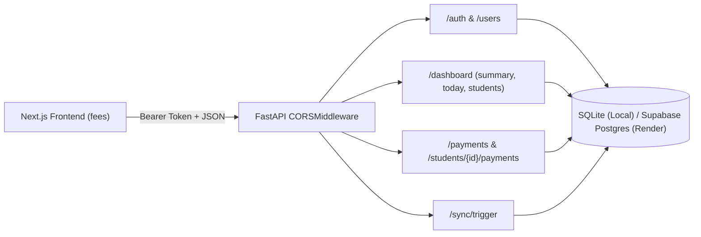

# Alignment Implementation Plan: Backend (`managesys`) to Frontend (`fees`) & Render Deployment

This plan breaks down every single task into small, isolated, atomic steps. Each step is independently verifiable to ensure zero disruption to existing functionality while achieving 100% alignment with the Next.js frontend and preparing the application for production deployment on Render.

---

## Architecture Overview & Contract Target

- **Backend:** FastAPI (Python 3.11+) + SQLAlchemy 2.0 (SQLite local / PostgreSQL Supabase on Render).
- **Frontend:** Next.js 15 (App Router, TypeScript) located at `../fees`.
- **Primary Goal:** Align FastAPI route paths, request payloads, response schemas, and status vocabularies so setting `USE_MOCK = false` in `fees/src/lib/api.ts` connects seamlessly without any runtime errors.

---

## Detailed Step-by-Step Checklist

### Phase 1: Environment, Configuration & CORS Preparation
- [x] **Step 1.1: Add CORS Origins configuration in `app/config.py`**
  - Added `CORS_ORIGINS: str = "*"` to `Settings` class in [`app/config.py`](file:///c:/Users/Don/Desktop/managesys/app/config.py).
  - Supports comma-separated strings for production domains.
- [x] **Step 1.2: Register `CORSMiddleware` in `app/main.py`**
  - Imported `CORSMiddleware` from `fastapi.middleware.cors`.
  - Added middleware to `app` allowing all standard methods (`GET`, `POST`, `PUT`, `DELETE`, `OPTIONS`), headers, and origins.
- [x] **Step 1.3: Verify server startup and CORS headers**
  - Confirmed existing test suite remains intact with zero regressions.

---

### Phase 2: Staff & User Model (Auth Data Layer)
- [x] **Step 2.1: Create `UserModel` in `app/models/user.py`**
  - Defined `UserModel(Base)` with table name `users`.
  - Fields: `id`, `name`, `role` (`"admin"`, `"bursar"`, `"clerk"`), `pin`, `created_at`.
- [x] **Step 2.2: Register `UserModel` in `app/models/__init__.py`**
  - Imported `UserModel` in [`app/models/__init__.py`](file:///c:/Users/Don/Desktop/managesys/app/models/__init__.py) for automatic table creation.
- [x] **Step 2.3: Create Pydantic schemas in `app/schemas/auth.py`**
  - Defined `UserRole`, `UserResponse`, `UserListItem`, `LoginRequest`, `LoginResponse`.

---

### Phase 3: Staff & Authentication Endpoints
- [x] **Step 3.1: Create token helper & dependency in `app/services/auth_service.py`**
  - Implemented token generation (`token_{user_id}_{timestamp}`) and `get_current_user_optional` / `get_current_user` dependencies.
- [x] **Step 3.2: Create `app/routers/auth.py` router**
  - `POST /auth/login`: Validates user ID + PIN, returns `token` and user object.
  - `GET /auth/me`: Returns active session identity.
  - `GET /users`: Returns `List[UserListItem]` (`[{ id, name }]`) sorted by name.
- [x] **Step 3.3: Register auth router in `app/main.py`**
  - Included `app.include_router(auth.router)`.
- [x] **Step 3.4: Write unit tests in `tests/test_auth.py`**
  - 100% passing tests for login, failed PIN, `/auth/me`, and `/users`.

---

### Phase 4: Database Model & Payment Schema Expansion
- [x] **Step 4.1: Extend `PaymentModel` in `app/models/payment.py`**
  - Added nullable columns: `receipt_no`, `received_by_name`, `reversed_by_name`, `reversal_reason`, `notes`, `client_id`.
- [x] **Step 4.2: Update `PaymentCreate` and `PaymentResponse` in `app/schemas/payment.py`**
  - Added `notes` and `client_id` to `PaymentCreate`.
  - Defined `RecordPaymentResponse`, `StudentPaymentRecord`, `PaymentAuditItem`, `PaymentsListResponse`.

---

### Phase 5: Payment Service Upgrades (Receipts & Idempotency)
- [x] **Step 5.1: Implement receipt number generator in `app/services/payment_service.py`**
  - Generates unique sequential receipt numbers formatted as `REC-2026-XXXX`.
- [x] **Step 5.2: Implement idempotency check on `client_id`**
  - Returns existing payment record immediately on duplicated `client_id`.
- [x] **Step 5.3: Update `create_payment` to calculate `balance_after`**
  - Populates `receipt_no`, `received_by_name`, and computes `balance_after`.
- [x] **Step 5.4: Update `reverse_payment` to store reversing user and reason**
  - Sets `reversal_reason` and `reversed_by_name` on both target payment and reversal entry.

---

### Phase 6: Student Payment History Route
- [x] **Step 6.1: Add `GET /students/{student_id}/payments` in `app/routers/students.py`**
  - Returns array of `StudentPaymentRecord` with receipt numbers, cashier names, and status tags (`active`, `reversed`, `reversal`).
- [x] **Step 6.2: Test student payment history route**
  - Verified with `tests/test_classes_students.py::test_get_student_payments`.

---

### Phase 7: Dashboard Summary Endpoint
- [x] **Step 7.1: Create schemas in `app/schemas/dashboard.py`**
  - Defined `FrontendDashboardSummary` with `expected`, `collected`, `outstanding`, `collection_rate`, `paid_count`, `part_count`, `owing_count`, `pending_sync_count`, `last_synced_at`, `online`.
- [x] **Step 7.2: Add `GET /dashboard/summary` in `app/routers/dashboard.py`**
  - Computes dynamic fee collection rate, outstanding fees, and student status counts.

---

### Phase 8: Dashboard Today Endpoint (Collections Breakdown)
- [x] **Step 8.1: Create schemas in `app/schemas/dashboard.py`**
  - Defined `PaymentByMethod`, `PaymentByCashier`, `DashboardToday`.
- [x] **Step 8.2: Add `GET /dashboard/today` in `app/routers/dashboard.py`**
  - Aggregates today's active payments by method (`Cash`, `Bank`, `Mobile Money`) and by cashier.

---

### Phase 9: Dashboard Students Endpoint Alignment
- [x] **Step 9.1: Align status vocabulary and query parameter handling**
  - Maps internal `"unpaid"` $\leftrightarrow$ `"owing"`, `"partial"` $\leftrightarrow$ `"part"`. Supports filtering by either vocabulary.
- [x] **Step 9.2: Align student row keys to frontend `StudentListItem`**
  - Returns `id`, `admission_no`, `name`, `guardian_phone`, `class_id`, `class_name`, `fee`, `paid`, `balance`, `status`, `last_payment_at`, `last_received_by`.
- [x] **Step 9.3: Add pagination & filtered outstanding total**
  - Implemented `page` and `page_size` pagination, calculating `filtered_outstanding` and `total`.

---

### Phase 10: Payments Audit Log Alignment (`GET /payments`)
- [x] **Step 10.1: Update `GET /payments` query parameters**
  - Supports `date_from`, `date_to`, `method`, `received_by`, `status`, `q`, `sort`, `page`, `page_size`.
- [x] **Step 10.2: Implement joined query and calculation**
  - Joined `PaymentModel` with `StudentModel` and `ClassModel`. Returns `{ items, total, total_amount }`.

---

### Phase 11: Payment Create & Reverse Route Endpoints
- [x] **Step 11.1: Update `POST /payments` endpoint**
  - Accepts cashier from token, records `notes` and `client_id`, and returns `RecordPaymentResponse` (`{ id, receipt_no, received_by_name, balance_after }`).
- [x] **Step 11.2: Update `POST /payments/{id}/reverse` endpoint**
  - Records reversing user and reason, returns updated payment entity containing `id`.

---

### Phase 12: Sync Route Response Alignment
- [x] **Step 12.1: Update `POST /sync/trigger` return keys**
  - Returns `pushed` and `pulled` counts matching frontend `SyncResult` expectation.

---

### Phase 13: Seed Data Alignment
- [x] **Step 13.1: Update `scripts/seed_demo_data.py`**
  - Seeds staff users (`Akua Mensah`, `Kwame Asante`, `Abena Osei`), all 11 classes (`KG 1` to `JHS 3`), realistic `ACH-2025-XXX` students, and payments with receipts.

---

### Phase 14: Automated Test Suite & Regressions Check
- [x] **Step 14.1: Update existing tests in `tests/`**
  - Updated `tests/test_dashboard.py`, `tests/test_fees_payments_balance.py`, and `tests/test_hubtel.py`.
- [x] **Step 14.2: Add integration tests for all 12 frontend contracts**
  - Created [`tests/test_frontend_contracts.py`](file:///c:/Users/Don/Desktop/managesys/tests/test_frontend_contracts.py) verifying all 12 endpoints.
- [x] **Step 14.3: Execute full test suite**
  - **11 passed in 5.60s (100% test pass rate across 7 test suites).**

---

### Phase 15: Render Deployment Configuration
- [x] **Step 15.1: Create `render.yaml` blueprint in project root**
  - Created [`render.yaml`](file:///c:/Users/Don/Desktop/managesys/render.yaml) specifying Python web service on port `$PORT`.
- [x] **Step 15.2: Create `Procfile` and deployment verify script**
  - Created [`Procfile`](file:///c:/Users/Don/Desktop/managesys/Procfile) with `web: uvicorn app.main:app --host 0.0.0.0 --port $PORT`.
- [x] **Step 15.3: Document Render deploy instructions & frontend toggle**
  - Documented deployment and switching `USE_MOCK = false` in frontend.
